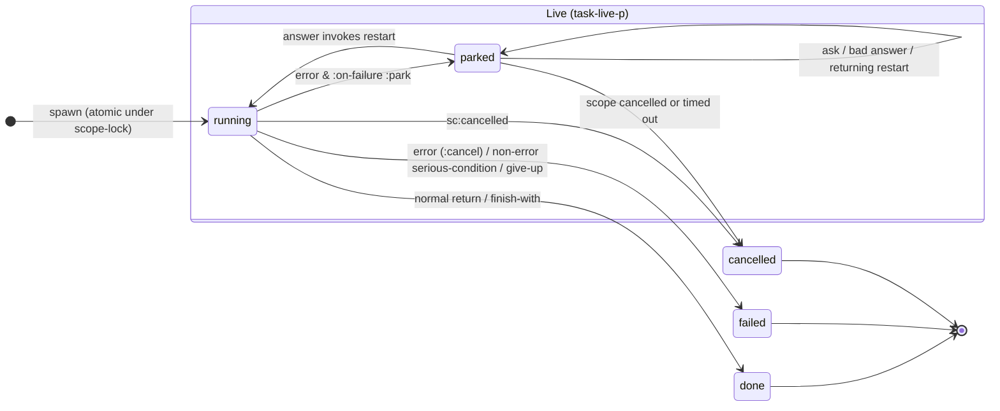
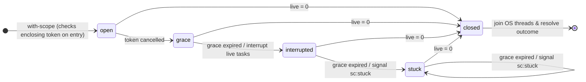

# cl-scope

Structured concurrency for SBCL on native OS threads — with **cooperative cancellation** and **live failure parking**.

- **Zero external dependencies**: uses only SBCL built-ins (`sb-thread`, `sb-ext`, `sb-debug`).
- **No leaked threads**: every task belongs to a lexical scope that joins all child tasks before exiting.
- **Clean cancellation**: cancellations wake blocked waits (sleeps, channels, and any blocking call you wrap with `call-with-waker`) via wakers instead of blindly interrupting threads.
- **Park & recover in place**: with `:on-failure :park`, a failing task freezes on its real call stack instead of unwinding, letting another thread inspect its live state (`ask`), hot-redefine broken code, and resume it via Common Lisp restarts (`answer`).

Package: `cl-scope` (nickname: `sc`). SBCL only.

---

## Quick Start

### 1. Run tasks concurrently with automatic join and timeout

```lisp
;; Wait for multiple tasks and collect their first return values in order.
;; If any task fails (or 10s pass), all sibling tasks are cancelled and joined.
(sc:gather (list (lambda () (sc:pause 0.2) :one)
                 (lambda () (sc:pause 0.1) :two))
           :timeout 10)
;; => (:ONE :TWO)

;; Or manage tasks explicitly inside a scope:
(sc:with-scope (s :name "build" :timeout 30)
  (sc:spawn (lambda () (sc:pause 1) :built) :name "build")
  (sc:spawn (lambda () (sc:pause 0.5) :ready) :name "warmup")
  ;; The scope does not return until both tasks have finished (or been cancelled).
  :started)
```

### 2. Freeze a failing task and recover it live (`:on-failure :park`)

Instead of cancelling siblings and losing in-flight work on an unexpected error, park the failed task in place:

```lisp
(defvar *request-id* nil)

(defun compute (x)
  (error "buggy implementation for ~a" x))

(let ((parked-events (sc:make-chan)))
  (let ((sc:*on-park* (lambda (task) (sc:send parked-events task))))
    ;; Supervisor thread: inspect the parked task, fix the function, and retry it.
    (sb-thread:make-thread
     (lambda ()
       (let ((task (sc:recv parked-events)))
         (format t "Failed with: ~a~%" (sc:task-condition task))
         (format t "Stack: ~s~%" (sc:task-report task))
         (format t "Restarts: ~s~%" (sc:task-restarts task))
         ;; Evaluate code inside the parked task's thread & live dynamic bindings:
         (format t "Request ID: ~s~%" (sc:ask task (lambda () *request-id*)))

         ;; Hot-fix the broken function and resume the task in place:
         (defun compute (x) (* x 2))
         (sc:answer task 'sc:retry))))

    ;; Sibling tasks keep running while the failed one is parked.
    (sc:gather (list (lambda () (let ((*request-id* "req-42")) (compute 21)))
                     (lambda () (sc:pause 0.1) :ok))
               :on-failure :park)))
;; => (42 :OK)
```

### 3. Make any blocking call cancellable (`call-with-waker`)

```lisp
(defun cancellable-read-byte (socket stream)
  (sc:call-with-waker
   ;; Waker: called from another thread when the scope is cancelled.
   (lambda () (ignore-errors (sb-bsd-sockets:socket-shutdown socket :direction :io)))
   ;; Blocking operation:
   (lambda () (read-byte stream nil :eof))))
```

`test.lisp` has two more: `run`, which kills a child process and its process group, and `read-line-from`, which shuts a socket down.

---

## Core Concepts

```text
  with-scope (owns a cancellation token + task list)
   ├── task A (:running)  ── waiting on pause / recv / wait-on / waker
   ├── task B (:running)  ── nested with-scope (child token)
   │    └── task B1       ── cancelled automatically when parent cancels
   └── task C (signals an ERROR)
        ├── :on-failure :cancel (default)
        │     └─► cancels scope token ─► wakes A, B, B1 ─► joins all ─► signals TASK-ERROR
        └── :on-failure :park
              └─► freezes C on its real stack (A & B keep running)
                  └─► supervisor inspects via ASK / resumes via ANSWER (restart)
```

### 1. Scopes and Lifetime
- **Strict join**: `with-scope` never returns until every task spawned inside it has terminated and its OS thread has been joined.
- **Closed on exit**: once a scope finishes joining, spawning into it signals an error. Calling `spawn` outside any scope is also an error.
- **Body errors**: if the body of `with-scope` exits via a non-local transfer or error, all child tasks are cancelled and joined before the body's error propagates.
- **Nesting**: scopes form a tree of cancellation tokens. Cancelling an outer scope cascades to all inner scopes; inner tasks unwind and finish before their parent task exits.
- **Dynamic bindings (`*inherit*`)**: spawned threads do not blindly copy all thread-local bindings. Only special variables listed in `sc:*inherit*` (plus `*inherit*` and `*on-park*`) are captured at `spawn` time and bound in the child thread.

### 2. Cooperative Cancellation
Cancellation in `cl-scope` is **cooperative first, preemptive only as a last resort**:

1. Every scope holds a cancellation token. Every built-in wait (`pause`, `recv`, `wait-on`) and `call-with-waker` registers a **waker** on that token.
2. When a scope is cancelled (via `cancel-scope`, `:timeout`, a body error, or a sibling failure under `:on-failure :cancel`), all wakers fire immediately — broadcasting condition variables, or calling the waker given to `call-with-waker` (which might shut a socket down or kill a process) — and the waiting call signals `sc:cancelled`.
3. **`cancelled` is a `condition`, not an `error` or `serious-condition`**: task code using `(ignore-errors ...)` or `(handler-case ... (error ...))` will **not** accidentally swallow a cancellation.
4. **Cleanup (`shielded`)**: waits inside an `unwind-protect` cleanup are also cancelled immediately unless wrapped in `(sc:shielded ...)`, which runs outside every scope's cancellation token.
5. **Grace period & fallback**: if a cancelled task is stuck in a tight CPU loop or a non-`cl-scope` wait (such as `cl:sleep`) and does not exit within `:grace` seconds (default `1`), `cl-scope` falls back to `sb-thread:interrupt-thread`. If the thread still cannot be interrupted (e.g. inside `without-interrupts`), the scope stays open and signals `sc:stuck` (via `signal`) once per grace period until the task exits.

### 3. Failure Parking (`:on-failure :park`)
When a scope is created with `:on-failure :park`:

- Any `error` signalled inside a task pauses that task **at the exact point of failure**, preserving its real SBCL call stack, local frames, and dynamic bindings. Non-`error` `serious-condition`s (such as stack/heap exhaustion) still unwind normally.
- Sibling tasks in the same scope continue running unaffected.
- Another thread (a REPL, supervisor, or agent) can:
  - find parked tasks via `(sc:parked scope)` or receive them immediately via `sc:*on-park*`;
  - inspect the failure via `task-condition`, `task-report` (trimmed backtrace), and `task-restarts`;
  - run diagnostic code **inside the parked thread's dynamic context** via `(sc:ask task thunk)`;
  - resume the task via `(sc:answer task restart-name &rest args)`.
- **Built-in restarts**: unless spawned with `:restarts nil`, every task establishes three restarts alongside any restarts established by user code:
  - `sc:retry` — re-run the task thunk from the start in the same thread (picking up any redefined functions).
  - `sc:give-up` — end the task as `:failed`, cancelling the scope and signalling `task-error`.
  - `sc:finish-with (&rest values)` — complete the task normally with `values`.
- **Bad answers stay safe**: passing an unknown restart name, wrong arguments, or invoking a restart that returns without transferring control leaves the task `:parked` and records the reason in `(sc:task-note task)`.
- **Scope cancellation wins**: if the scope is cancelled or times out while a task is parked, the parked task is woken and unwound cleanly.

### 4. State Machines

`cl-scope` models task execution, scope shutdown, and scope exit resolution as explicit state machines.

#### Task Lifecycle (`task-state`)

Tasks are admitted atomically under `scope-lock` (the OS thread is created before recording the task), so no half-born task is ever visible to `join`. A task is considered **live** (`task-live-p`) while `:running` or `:parked`, and **terminal** once `:done`, `:failed`, or `:cancelled`:



#### Scope Shutdown Lifecycle (`join`)

Once a scope enters `join`, it transitions monotonically through explicit shutdown phases until `live = 0`, then joins every OS thread before returning:



#### Scope Exit Outcome (`scope-outcome`)

If the body of `with-scope` unwinds via an error, non-local transfer, or outer cancellation, the scope cancels its tasks (`:scope-exit`), joins them, and lets the unwind continue. Otherwise, once `join` closes the scope, its outcome is resolved exhaustively in priority order:

| Priority | Condition after `join` | Outcome | `with-scope` result |
|---|---|---|---|
| 1 | First task failure recorded (`scope-failure`) | `:failed` | Signals `sc:task-error` |
| 2 | Scope token not cancelled | `:completed` | Returns body's values |
| 3 | Token cancelled by an ancestor scope (`origin ≠ self`) | `:outer-cancelled` | Signals `sc:cancelled` (propagates even if cancelled during `join`) |
| 4 | Token cancelled by this scope's `:timeout` | `:timed-out` | Signals `sc:timed-out` |
| 5 | Token cancelled directly on this scope (`cancel-scope`) | `:cancelled` | Returns `nil` |

---

## Installation & Loading

`cl-scope` has no external dependencies. Load it directly with ASDF:

```lisp
(asdf:load-asd "/path/to/cl-scope/cl-scope.asd")
(asdf:load-system "cl-scope")
```

Or add its directory to `CL_SOURCE_REGISTRY` (e.g. `/path/to/cl-scope//:`) and call `(asdf:load-system "cl-scope")`.

With [qlot](https://github.com/fukamachi/qlot):

```text
git cl-scope https://github.com/nohzafk/cl-scope.git
```

---

## API Reference

### Scopes & Tasks

| Symbol | Description |
|---|---|
| `(sc:with-scope (var &key name (on-failure :cancel) timeout (grace 1)) &body body)` | Run `body` with `var` bound to a new scope. Joins all spawned tasks before returning `body`'s values (or `nil` if cancelled directly on this scope). `:on-failure` is `:cancel` or `:park`. `:timeout` is in seconds. `:grace` is seconds before interrupting uncooperative tasks. |
| `(sc:spawn fn &key name (scope *scope*) (restarts t))` | Start zero-arg `fn` in a new OS thread attached to `scope`; returns the `task`. Pass `:restarts nil` to omit the built-in `retry`, `give-up`, and `finish-with` restarts. |
| `(sc:gather thunks &key name (on-failure :cancel) timeout)` | Run each zero-arg function in `thunks` concurrently in one scope and return a list of their first return values, in input order. |
| `(sc:cancel-scope scope &optional (reason :asked))` | Cancel `scope` and all nested scopes. Returns `t` if this call triggered cancellation, `nil` if already cancelled. |
| `(sc:scope-name scope)` / `(sc:scope-tasks scope)` | Access the scope's name and list of spawned tasks. |
| `(sc:task-name task)` / `(sc:task-scope task)` / `(sc:task-thread task)` | Task metadata and underlying SBCL thread. |
| `(sc:task-state task)` | Current state: `:running`, `:parked`, `:done`, `:failed`, or `:cancelled`. |
| `(sc:task-values task)` | List of return values once `:done`. |
| `(sc:task-condition task)` / `(sc:task-report task)` | Signalled condition and trimmed stack trace lines (list of strings) when `:parked` or `:failed`. |
| `(sc:task-restarts task)` / `(sc:task-note task)` | Available restart names while `:parked`, and diagnostic message if the last `answer` failed. |

### Cancellable Waits & Synchronization

| Symbol | Description |
|---|---|
| `(sc:pause seconds)` | Sleep for `seconds`; wakes immediately with `cancelled` if the scope is cancelled. Returns `nil`. |
| `(sc:make-chan)` | Create an unbounded thread-safe FIFO channel. |
| `(sc:send chan x)` | Push `x` onto `chan` and wake waiters. Returns `x`. |
| `(sc:recv chan &key timeout)` | Pop the next item from `chan`. Returns `(values item t)`, or `(values nil nil)` on timeout. Cancellable. |
| `(sc:wait-on lock queue test &key timeout)` | Acquire `lock` and wait on `queue` until `(funcall test)` returns a non-nil value (called with `lock` held), or until `timeout` seconds pass (`nil`). Cancellable. |
| `(sc:call-with-waker waker thunk)` | Run blocking `thunk`; if cancelled, invokes `waker` from the cancelling thread and signals `cancelled`. |
| `(sc:check)` | Poll point: signals `cancelled` immediately if the current scope is cancelled. |
| `(sc:shielded &body body)` | Evaluate `body` outside every scope's cancellation token (for cleanup that must complete). |

### Parked Task Control (`:on-failure :park`)

| Symbol | Description |
|---|---|
| `(sc:parked scope)` | Return the list of currently `:parked` tasks in `scope`. |
| `(sc:answer task restart &rest args)` | Instruct a parked `task` to invoke `restart` with `args` inside its own thread. Returns `task`. |
| `(sc:ask task thunk &key (timeout 5))` | Run zero-arg `thunk` inside the parked `task`'s thread (with its live dynamic bindings) and return its values (or `(values :error message)` if `thunk` errors; no values on timeout). |
| `sc:retry` / `sc:give-up` / `sc:finish-with` | Built-in restart names offered by each task (unless `:restarts nil`). |

### Conditions & Special Variables

| Symbol | Kind | Notes |
|---|---|---|
| `sc:cancelled` | `condition` | Not an `error`. Reader: `(sc:cancelled-reason c)`. |
| `sc:task-error` | `error` | Signalled by `with-scope` when a task fails. Readers: `sc:task-error-task`, `sc:task-error-condition`. |
| `sc:timed-out` | `error` | Signalled by `with-scope` when `:timeout` expires. |
| `sc:stuck` | `condition` | Signalled via `signal` every `:grace` seconds when cancelled tasks ignore interruption. Reader: `(sc:stuck-tasks c)`. |
| `sc:*on-park*` | variable | `nil` or `(lambda (task) ...)`, called inside the failing task's thread right after it enters `:parked`. |
| `sc:*inherit*` | variable | List of special variable symbols whose current bindings are copied into newly spawned tasks. |

---

## Testing

Run the full check suite (32 checks, ~6 seconds) or the mutation suite (11 mutants, ~2 minutes):

```sh
./check.sh        # -v prints measured timings and diagnostics
./mutants.sh      # removes 11 core behaviours one by one and verifies each fails a check
```

Or from Lisp via ASDF:

```lisp
(asdf:test-system "cl-scope")
```

The test suite (`test.lisp`) covers:
- **S1–S13 (Scopes)**: join semantics, sibling cancellation on failure, body errors, nested inner-first unwind, timeouts, closed-scope rejection, `gather` ordering, `*inherit*`, 200 concurrent tasks, outer cancellation during `join` / pre-cancelled entry, direct `cancel-scope` during `join`, failed `spawn` cleanup, and cycle-safe REPL printing.
- **W1–W8 (Cancellation)**: waking `pause`, `recv`, a child process and its process group, and a socket read (the last two through `call-with-waker`), grace-period interrupt fallback, `stuck` signalling under `without-interrupts`, `shielded` cleanup, and failing-waker isolation.
- **P1–P10 (Parking)**: freezing a task while siblings finish, in-thread inspection with `ask`, live function redefinition + `retry`, `give-up`, scope timeout cancelling parked tasks, invalid restart diagnostics via `task-note`, multiple parked tasks, `:restarts nil`, interrupting a parked task stuck in `*on-park*`, and automatic inheritance of dynamically bound `*on-park*`.
- **Thread leak check**: verifies every test returns with zero leaked SBCL threads.

---

## Known Limitations

- **SBCL only**: relies directly on `sb-thread`, `sb-ext` (timers), and `sb-debug`. The tests also use `sb-bsd-sockets` and `sb-ext:run-program`.
- **Mutex waits**: a thread blocked acquiring a plain mutex (rather than `wait-on`) is only stopped once the grace-period interrupt fires.
- **Asynchronous interrupt fallback**: the grace-period `sb-thread:interrupt-thread` fallback can land inside arbitrary cleanup code; always prefer waker-backed waits where possible.
- **Foreign blocking calls**: CFFI / foreign blocking calls require a custom waker via `call-with-waker`.
- **OS threads**: each task uses a real SBCL OS thread (tested up to 200 concurrent tasks). Parked tasks keep their thread alive until answered or cancelled.

---

## Related Work

- **[cl-cancel](https://github.com/atgreen/cl-cancel)**: provides hierarchical cancellation tokens, deadlines, and stream-closing cancellation, but no task scopes (no structured join or sibling cancellation on failure).
- **[bordeaux-threads](https://sionescu.github.io/bordeaux-threads/)**: portable thread abstraction layer across CL implementations (a natural starting point if porting `cl-scope` beyond SBCL).
- **CPS / green-thread libraries** (`cl-cont`, `green-threads`, `blackbird`): rewrite tasks into closure chains; `cl-scope` intentionally uses real SBCL threads so parked tasks retain genuine call stacks for backtraces, `ask`, and Common Lisp restarts.

---

## License

MIT. See [LICENSE](LICENSE).
